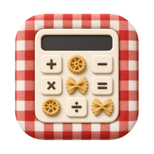
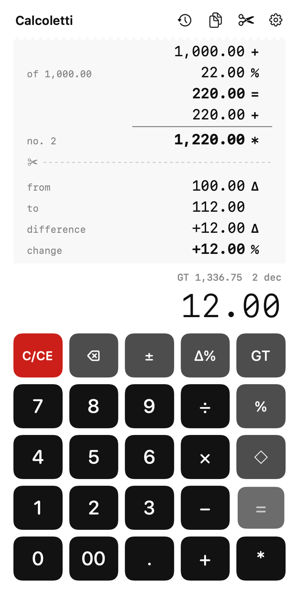
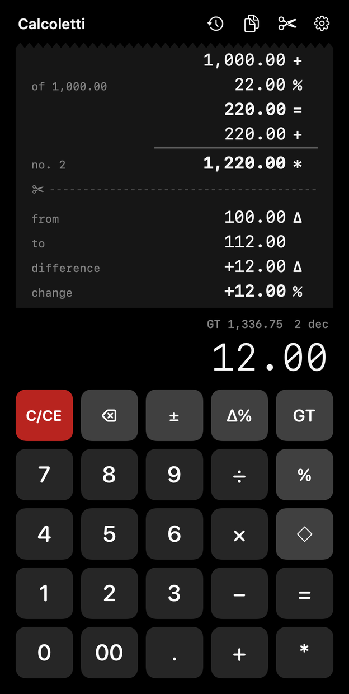
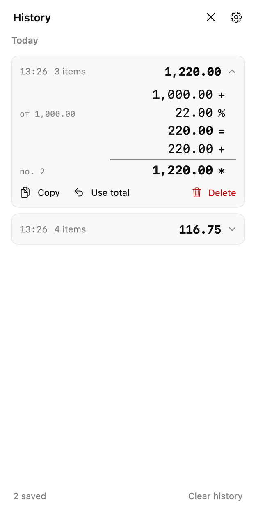
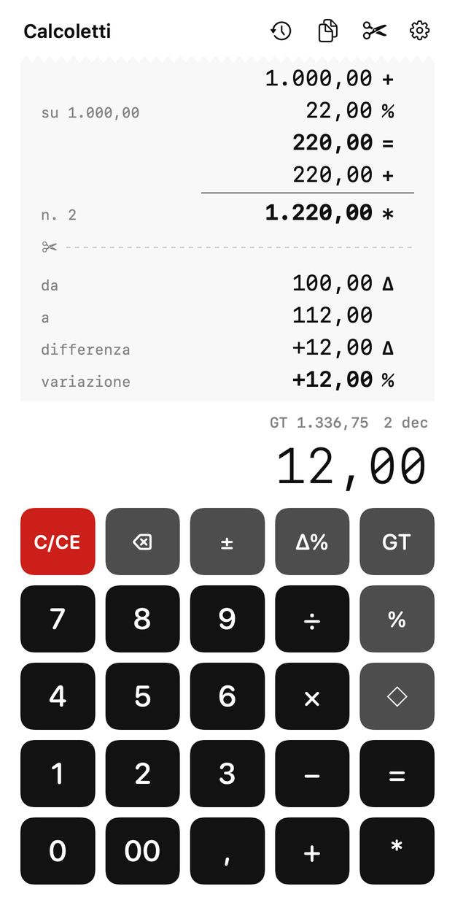

<p align="center">
  
</p>

<h1 align="center">Calcoletti</h1>

<p align="center">
  <b>The receipt calculator for your Mac menu bar.</b><br>
  Your sums, printed on a paper tape — like a classic printing calculator.
</p>

<p align="center">
  <a href="https://github.com/MrGriggio/calcoletti/releases/latest"><b>⬇︎ Download Calcoletti.dmg</b></a>
  &nbsp;·&nbsp; macOS 13 Ventura or later &nbsp;·&nbsp; Apple Silicon &amp; Intel
  &nbsp;·&nbsp; <a href="#italiano">🇮🇹 Italiano</a>
</p>

<p align="center">
  
  &nbsp;
  
  &nbsp;
  
</p>

## Features

- **Lives in the menu bar** – a small pasta bow‑tie icon, one click away. No Dock icon.
- **Paper tape** – every number you type is printed line by line, with `+`, `−`, subtotal `◇` and total `*`, item count and red ink for subtractions. Click any number on the tape to reuse it.
- **Adding‑machine logic** – the way printing calculators work: `12.50 + 7.25 + 3 − ◇ … *`.
- **Δ% key** – percent change: `100 Δ% 112 =` → difference +12, change **+12.00 %**.
- **Percent & VAT** – `1000 + 22 %` → 220, then `+` to reach 1,220. Also `×` / `÷` with `%`.
- **Grand total (GT)**, `00` key, sign change, backspace, decimals F / 0 / 2 / 3 / 4.
- **History** – every total is saved, grouped by day: reopen, copy as text, reuse the total, delete.
- **Light by day, dark by night** – switches automatically at the hours you choose (or always light / dark).
- **Full keyboard control** and **English / Italian** (follows your Mac's language, including number format).
- Opens at login. All data stays on your Mac.

### Keyboard

| Key | Action | Key | Action |
|---|---|---|---|
| `0`–`9` `.` `,` | type | `Return` | `=` or total |
| `+` `-` | add / subtract | `*` `x` `/` | multiply / divide |
| `S` | subtotal ◇ | `T` | total * |
| `D` | Δ% | `%` | percent |
| `G` | grand total (twice to clear) | `N` | change sign |
| `Esc` | C/CE | `⌫` | delete digit |
| `H` | history | `⌘C` / `⌘V` | copy tape / paste number |

## Install

1. Download **Calcoletti.dmg** from the [latest release](https://github.com/MrGriggio/calcoletti/releases/latest).
2. Open it and drag **Calcoletti** into **Applications**.
3. The app is not signed with an Apple Developer ID, so the first time macOS blocks it:
   open **System Settings → Privacy & Security**, scroll down and click **Open Anyway**.
   Or, in Terminal: `xattr -dr com.apple.quarantine /Applications/Calcoletti.app`

The pasta bow‑tie appears in your menu bar.

## Build from source

You need a Mac with the Xcode command line tools (`xcode-select --install`).

```bash
git clone https://github.com/MrGriggio/calcoletti.git
cd calcoletti
bash build.sh        # → build/Calcoletti.app and build/Calcoletti.dmg (universal)
bash installa.sh     # builds, installs to /Applications and launches
```

No Xcode project needed: it's plain SwiftUI + AppKit compiled with `swiftc`.

| File | What it does |
|---|---|
| `Sources/Engine.swift` | Calculator logic (adding‑machine), tape, history, number formatting – Foundation only |
| `Sources/App.swift` | Menu bar app, SwiftUI interface, keyboard, themes, settings |
| `Sources/SelfTest.swift` | Automatic test (`--selftest`) and frame capture for videos (`--demo`) |
| `.github/workflows/build.yml` | Builds on GitHub's Macs, runs the tests and publishes the `.dmg` release |

Every push to `main` is built and tested on macOS by GitHub Actions; if the checks pass, the new `Calcoletti.dmg` replaces the one in the latest release.

## Contributing

Issues and pull requests are welcome. Please keep the app small, simple and offline.

## License

[MIT](LICENSE)

---

<a id="italiano"></a>
## 🇮🇹 Italiano

**Calcoletti** è una calcolatrice a scontrino che vive nella barra dei menu del Mac: i conti escono stampati riga per riga, come su una calcolatrice scrivente Olivetti.

<p align="center"></p>

**Cosa fa:** somme e sottrazioni con subtotale `◇` e totale `*`, numero di voci, sottrazioni in rosso; tasto **Δ%** per la variazione percentuale (`100 Δ% 112 =` → +12 %); percentuale e IVA (`1000 + 22 %` → 220, poi `+` per arrivare a 1.220); gran totale GT; **cronologia** di tutti i conti divisa per giorno; tema **chiaro di giorno e scuro la sera**; tutto anche da tastiera. L'app è in italiano quando il Mac è in italiano (numeri nel formato 1.220,00).

**Installazione:** scarica **Calcoletti.dmg** dall'[ultima release](https://github.com/MrGriggio/calcoletti/releases/latest), aprilo e trascina Calcoletti in Applicazioni. Al primo avvio: **Impostazioni di Sistema → Privacy e sicurezza → Apri comunque** (l'app non è firmata con un account sviluppatore Apple).

**Tastiera:** Invio = / totale · S subtotale · T totale · D delta % · G gran totale · N cambia segno · Esc C/CE · H cronologia · ⌘C copia lo scontrino · ⌘V incolla un numero.

**Compilarla da soli:** `bash build.sh` su un Mac con gli strumenti da riga di comando di Xcode. Dettagli in [LEGGIMI.txt](LEGGIMI.txt).

Licenza MIT: puoi usarla, modificarla e ridistribuirla liberamente.
